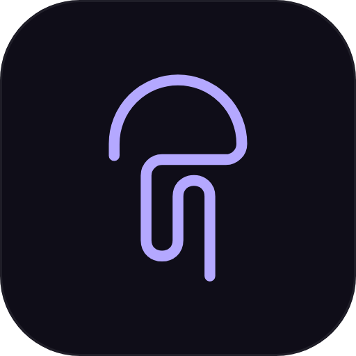

# una

<p align="center"></p>

**Never lose the thread. One assistant for everything you're building.**

Una is a chief of staff for a builder's work: you talk, she decides and runs it to done, and you only ever check her.

## What she does

- **Decides with the whole picture.** She holds every repo, every task and every past decision, so you never re-explain. Workers are juniors who execute her spec; she decides the approach and writes every brief with a "Done means:" checklist.
- **Checks every result herself.** When a worker finishes, she judges the real result against that checklist (the diff, the tests, the screenshots) before it counts. Pass, and it counts. Fail, and one retry that names the gap; a second fail goes to you with the evidence. A task stays at "verify" in the window until her written verdict exists. This holds day and night.
- **Finishes work and keeps it moving.** She prepares, plans with you, then runs an approved plan without asking again. She decides small things inside your past decisions, logs why and how to undo it, and leaves the real calls in one "needs you" queue.
- **Works while you're away.** After you've been gone a while she works the pending list overnight: local and reversible steps only, within a spending cap, and she wakes again after a usage limit resets. When you're back she opens with one briefing: done, decided alone, needs you.
- **Keeps a day rhythm.** Your first message of the day gets one short morning briefing (today's focus, what is due or waiting on someone, what is nearest to done, what she starts now). She asks about your meetings and how much of the week's usage is left, and the night cap uses that until the weekly reset. At the end of the day (`DAY_WRAP_HOUR`, once, only if you wrote that day and she is idle) she posts one short wrap. When a task closes she proposes the next one, and anything waiting on someone for more than a working day gets one ready-to-send follow-up.
- **Truth, not guesses.** She never answers about code, CI or a PR from memory. If she hasn't checked it in this conversation she says "checking" and sends a reader first. A status is only what was verified, and if she gets something wrong she corrects it in one line. "Pushed", "merged", "live", "connected" and "fixed" are only said after she has looked herself; until then it is "not checked yet".
- **Says it when she is blocked.** When a fence stops a worker, the reply opens with what was stopped and the one thing you must do, and the card shows needs-you.
- **Keeps the load honest.** When you start something new while eight or more things are open (`LOAD_NUDGE_AT`), she says so once and names the two nearest to done. The hidden conversation is renewed only when it is heavy and idle (no worker running, no result waiting for her check, two quiet minutes).

## Her brain

- Her craft ships in this repo: the job description (`hub-template/CLAUDE.md`, which opens with her Principles: how she thinks), her rules and the server that enforces them. Principles outrank everything else in it.
- Your world lives in your own TrueMemory (https://truememory.com), in a mind named "una" (found by name, created if missing, or set `TM_MIND_ID`).
- **A project map and one clean memory shape.** She builds `hub/mind/project-map.json` herself from your real work: projects, the features inside them (one plain line each) and sub-features under a parent. It starts empty and is never shared. Every memory is stored in one shape anchored to that map, in plain product words: "Project · Parent › Feature: what. Why: why. (Month Year)". Names resolve through aliases, PR numbers, branches and file paths are rejected, and a feature the map does not have yet needs a parent and a one-line description.
- **Progress and standing rules live in TrueMemory by themselves.** When a card's stage, state or focus changes, a plain-words progress memory is written; `current-work.md` (what is in focus and waiting) and `standing-rules.md` (every rule you have stated, numbered, in your words, in `hub/mind/standing-rules.md`) are kept current as knowledge docs.
- **A new machine restores itself.** On a fresh install whose TrueMemory already knows you, she rebuilds her notes from it (who you are, how you work, current work, standing rules) instead of starting from a blank First Contact, and only asks for the repos not yet cloned.
- Live state stays on your machine: the conversation, the cards, her checks and her notes in `./hub`.
- Status: click Connect TrueMemory in the window and run the proof (writes a memory, uploads a note, reads both back). Then `npm run seed` shows what she would send (a dry run) and `npm run seed:apply` uploads it. It seeds from your hub's own files: project notes (`mind/repos/*.md`), history (`history/*.md`), your agreement, her lessons and what is done. Decisions are not sent as raw text: they reach TrueMemory only through her `remember()` in the one shape. Re-running is safe (unchanged files are skipped, changed ones replaced), and the server re-syncs changed files after each conversation renewal.
- She asks her mind before answering or briefing on a task, remembers each decision, rule and correction with its reason as it happens, and saves new or changed project notes. Workers never touch the mind. If TrueMemory is not connected she says so once and works from the local notes.

## You stay in control

- **Pushing only on your word, for the item you named.** Push and PR unlock when your message says "push", "PR" as a command or "test passed"; "don't push" keeps them locked. The word covers only the work she dispatches in reply to that message, one push each, and if you named an item it covers only that item. "I merged the PR" unlocks nothing. **Merging is always your click.**
- **Fences enforced in code, with tests.** Workers can never merge, push to main/master, force-push, hard-reset or run database migrations, seeds or resets. The one allowance: a Prisma migrate deploy, migrate reset or db push whose own command line points `DATABASE_URL` at a localhost database named `*_test`, `*_fidelity`, `*_scratch` or `*_tmp`.
- **Model picker.** Choose the model she thinks on from the window; workers default to Sonnet unless the brief names another.
- **Spending cap.** Night work stops at a per-night cap (and an optional share of a weekly budget). The spend figure is an estimate from her own session logs.
- **Read-only eyes.** She can look with read-only commands (git log/diff/status, `git -C`, gh pr view/checks, ls, cat, grep, `sed -n`, `jq`, curl GET, two of them joined by `&&`) and nothing that changes anything. A refusal says what to run instead. Everything else goes to a worker.
- **Worktree cleanup, only when provably safe.** When a task's card reaches merged or done, its git worktrees are removed if the PR is merged and nothing is uncommitted, unpushed or running in them; a full pass runs at the evening wrap, and main checkouts are never touched. Repos are found under `UNA_CODE_DIR`. See what it would do first with `npm run cleanup` (a dry run that writes `hub/mind/worktree-report.md`), and let it act with `npm run cleanup:apply`.

## The window

Focus cards for what you're really on, plus a pending list in priority order with a load meter that warns when too much is open. Pin answers to a side panel (with a Clear all), talk by voice (browser speech recognition, where available), drop or paste screenshots and files, light and dark. Esc pulls your last message back; while she's replying, Esc stops her and a quick second Esc recalls it. A TrueMemory pill in the top bar connects and proves your account.

## Requirements

- **Node 22+** (`node -v`)
- **Claude Code, signed in.** Run `claude` once and sign in (she uses that login), or set `ANTHROPIC_API_KEY`.
- **GitHub CLI, signed in.** `brew install gh`, then `gh auth login`.
- **git**
- **A TrueMemory account (required).** It signs in with email and password. If your account is Google-only, add a password once from the Connect panel ("Signed up with Google? Set a password"); Google sign-in keeps working. The sign-in is stored in the macOS Keychain.

## Start

```bash
git clone https://github.com/AbeerAlarean/una.git ~/una
cd ~/una
npm install
npm start
```

Open **http://localhost:4747**. She speaks first.

Once TrueMemory is connected, fill her mind from your hub:

```bash
npm run seed         # dry run: shows the plan, uploads nothing
npm run seed:apply   # uploads (safe to re-run)
```

### Run it as a service (macOS)

```bash
npm run install-service     # starts at login, restarts if she stops; log in ./data/una.log
npm run uninstall-service   # removes it; your hub and data are untouched
```

The service uses the node you ran the command with and this folder. `PORT`, `HUB_DIR` and `DATA_DIR`, if set when you install, are kept.

## First time

She introduces herself, checks your setup and tells you exactly what's missing (including "TrueMemory not connected" with the one-line fix: click Connect TrueMemory in the window). Then she asks which repos you work in, reads each with a worker (what it is, how to run it, its rules, your own PRs and branches), and drafts your workload for you to correct. A few questions, one at a time, about how you like to work, and after that you just talk.

## Settings (optional)

| Variable | Default | What |
|---|---|---|
| `PORT` | `4747` | where the window runs |
| `MAIN_MODEL` | `claude-opus-5-5` | the model she thinks on at first (the picker overrides it and is remembered) |
| `HUB_DIR` | `./hub` | her notes, created from `hub-template/` on first start |
| `DATA_DIR` | `./data` | your conversation, dropped files and her state files |
| `NIGHT_AWAY_MIN` | `45` | minutes without a message before she counts you as away |
| `NIGHT_HEARTBEAT_MIN` | `30` | how often she checks whether to start a night shift |
| `NIGHT_MAX_UNITS` | `30` | per-night spending cap, in estimated units |
| `NIGHT_WEEKLY_BUDGET_UNITS` | unset | optional weekly budget; the night uses at most half of what's left, spread over the days to reset |
| `NIGHT_WEEK_RESET_DOW` / `NIGHT_WEEK_RESET_HOUR` | `2` / `1` | weekday (0 = Sunday) and hour your weekly allowance resets |
| `NIGHT_CAFFEINATE` | unset | set to `1` to keep the Mac awake while she runs |
| `NIGHT_LOGS_DIR` | her Claude project logs | where the spend estimate reads |
| `DAY_WRAP_HOUR` | `18:30` | when the end-of-day wrap may fire (`18:30` or `18.5`) |
| `DAY_TZ` | system timezone | the timezone that decides "the first message of the day" and the wrap |
| `TM_MIND_ID` | unset | use this TrueMemory mind instead of the one named "una" |
| `ROTATE_TOKENS` | `160000` | the hidden conversation is renewed past this size (invisibly, only when idle: no worker, no turn, no result waiting for her check) |
| `LOAD_NUDGE_AT` | `8` | how many open tasks make her say "finish something first" when you start a new one |
| `UNA_CODE_DIR` | the folder that holds this one, else `~/Documents` | where worktree cleanup looks for your repos |
| `UNA_CLEANUP` | unset | set to `off` to turn automatic worktree cleanup off |
| `UNA_USER_SETTINGS` | unset | set to `off` to ignore your global Claude Code instructions |

If you change your Claude account or plan, restart her.

## Safety rails

Her own hands are limited to her notes, delegation and read-only looks; everything that changes something is a worker's. The fences hold even if the model forgets the rules, and `npm test` checks them (plus the night-shift and day-rhythm maths, the one-shot push gate, the TrueMemory seed planning and memory shape, the progress sync, the worktree-cleanup decisions, the check-before-done logic, the read-only allowlist and the TrueMemory helpers) without any model or network.

```bash
npm test
```

## Where your stuff lives

`hub/` (her notes) and `data/` (conversation, uploads, state) stay on your machine and are git-ignored. `git pull` never touches them. If `hub/mind/persona.md` exists she speaks in that voice; your agreement with her still wins where they differ.

## License

MIT, see [LICENSE](LICENSE).

## Upgrading from "Sahar"

una was called Sahar before. Run `npm run install-service` again: it removes the old `local.sahar` launch agent so only one runs. Your Keychain sign-in under `sahar.truememory` is moved to `una.truememory` automatically on first start. una looks for a mind named "una" first, then your old "Sahar" one, and only creates a new one if neither exists. Env vars `SAHAR_*` are now `UNA_*`; the old names still work. Your existing "Sahar" mind and memory space are used as they are.
